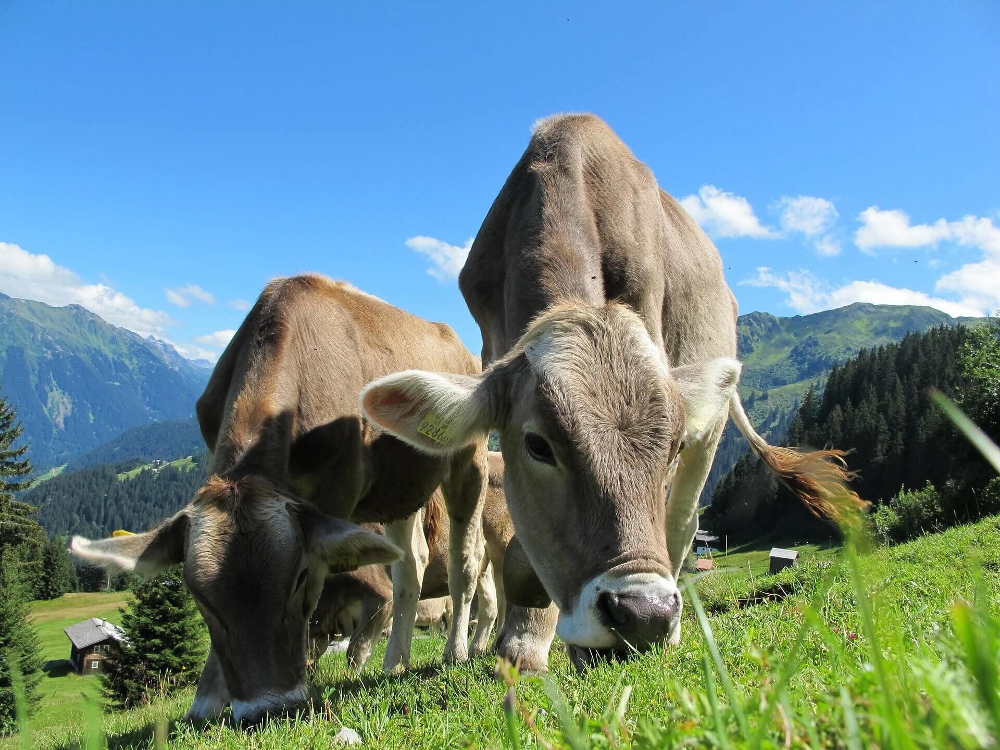
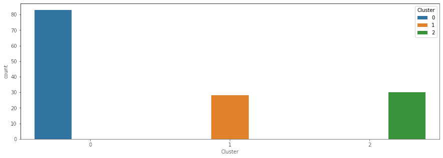

# ML Applications in Anthropology



This repository has two small Python projects. Both projects use machine learning and data tools on anthropology data. Each project makes an interactive map.

| Project | What it does | Folder |
| --- | --- | --- |
| Domesticated animals map | Shows the main domesticated animal of 118 societies | [domesticated-animals-map](domesticated-animals-map) |
| Clustering demo | Puts 141 societies into 3 groups with the K-Modes algorithm. Shows the groups on a map and in charts | [clustering-demo](clustering-demo) |

**See the maps online:** <https://dev.briannaimm.com/ml-applications-in-anthropology/>

## Data

Both projects use the same data. The data comes from D-PLACE, a database of cultural data. It describes 141 societies from the Standard Cross-Cultural Sample (SCCS).

Each society has these variables:

| Column | Meaning | Example values |
| --- | --- | --- |
| `domesticated_label` | The main domesticated animal | Pigs, Bovines, Camels, Small Species |
| `roleofgods_label` | The role of the gods | Absent, Otiose, Active (supporting morality) |
| `animalshunted_label` | The animals that people hunt | Large Game, Small Mammals, Birds or Waterfowl |
| `religion_label` | The main religion | Indigenous religion, Islamization, Christianization |
| `focal_year` | The year that the data describes | 1880 |

Two files in the [data](data) folder hold the data:

* `societies.csv` has the variables of all 141 societies.
* `coordinates.csv` has the latitude and longitude of 118 societies. Glottolog gave these coordinates. 23 societies have no coordinates. These societies appear in the clustering, but not on the maps.

[CREDITS.md](CREDITS.md) lists the sources, the icon authors and the software licenses.

## Project 1: Domesticated animals map

The script reads the data and makes one web page. The web page shows a map of the world. Each society has one animal icon on the map.

* Move the mouse over an icon to see the name of the society.
* Click an icon to see the focal year, the role of the gods, the animals that people hunt and the religion.
* Read the legend at the bottom left to see which icon shows which animal.

The script uses these libraries:

* **pandas** reads and joins the data.
* **Folium** makes the map.
* **Branca** makes the legend.

## Project 2: Clustering demo

Clustering puts similar items in the same group. This project uses clustering to find groups of societies that have similar animals, gods and religion.

The project uses the **K-Modes** algorithm. K-Modes is like K-Means, but it works with categories and not with numbers. The center of a group is the most common category of each variable.

The script does these steps:

1. It reads the data of 141 societies.
2. It calculates the cost of 1 to 5 groups and draws the elbow curve. A lower cost means a better fit.
3. It makes 3 groups.
4. It adds coordinates to the societies that have them.
5. It draws one count chart for each variable.
6. It makes a map. Each group has a different color.

> **Note:** The elbow curve has no sharp bend. The cost continues to decrease as the number of groups increases. The number 3 is a choice that is easy to read. It is not a proof.

K-Modes starts at random. The script uses a fixed seed (`SEED = 42`), so each run gives the same result.

### Results

These results come from the current script. The numbers are counts of societies.

| Group | Map color | Size | What the group has in common |
| --- | --- | --- | --- |
| 1 | Black | 69 | Gods are absent (50). Pigs are the main animal (23 of the 24 pig societies) |
| 2 | Green | 47 | Gods are otiose (27). Small animals are the main animal (31). People hunt two or more kinds of animal (26) |
| 3 | Red | 25 | Gods are active and support morality (22). Deep Islamization is common (14). Bovines (17) and camels (3) are the main animals |

The pig result is the most interesting one. Almost all pig societies are in group 1, where the gods are absent. The pig is a food taboo in Judaism and Islam. The result may support the idea that food taboos relate to the role of the gods. Correlation is not causation. Geography and indigenous religions also influence the groups.

> **Note:** Clusters are not exact. Many societies do not follow the pattern of their group.

The folder [clustering-demo/published](clustering-demo/published) keeps the charts and map from the original 2021 analysis. That analysis started from a different random state. The group sizes are a little different, but the main pattern is the same.



## How to run the projects

You need Python 3.9 or later.

1. Clone the repository and go to the folder:

   ```bash
   git clone https://github.com/briannarimm/ml-applications-in-anthropology.git
   cd ml-applications-in-anthropology
   ```

2. Make a virtual environment and install the libraries:

   ```bash
   python3 -m venv .venv
   source .venv/bin/activate
   pip install -r requirements.txt
   ```

3. Run the domesticated animals map:

   ```bash
   python domesticated-animals-map/map.py
   ```

   The script writes `domesticated-animals-map/output/animal_map.html`.

4. Run the clustering demo:

   ```bash
   python clustering-demo/clustering.py
   ```

   The script writes its results to `clustering-demo/output/`.

5. Show the maps. Start a local web server in the repository folder:

   ```bash
   python -m http.server 8000
   ```

   Open <http://localhost:8000> in a web browser. The start page is the same page as the online showcase.

> **Note:** The map in the browser loads map tiles from the internet. You need an internet connection to see the base map.

> **Note:** Do not move the HTML files. `animal_map.html` uses the icons in `assets/icons` through a relative link.

## Files in this repository

```text
data/                       Data of the societies (CSV)
assets/icons/               Animal icons for the map
assets/images/              Header images
domesticated-animals-map/   Project 1: map.py and its output
clustering-demo/            Project 2: clustering.py and its output
  published/                Charts and map from the 2021 analysis
index.html                  Start page for the online maps
requirements.txt            Python libraries
```

## How to use your own data

To change the map, change the CSV files in the `data` folder. Keep the column names. The `society_id` column links the two files.

To add an animal, add a line to the `ICONS` dictionary in `map.py` and put a PNG file in `assets/icons`. To change the number of groups, change `N_CLUSTERS` in `clustering.py`.

## Author

Brianna R. Imm

## License

The code is under the MIT License. See [LICENSE](LICENSE). The icons and the header images have their own licenses. See [CREDITS.md](CREDITS.md).
